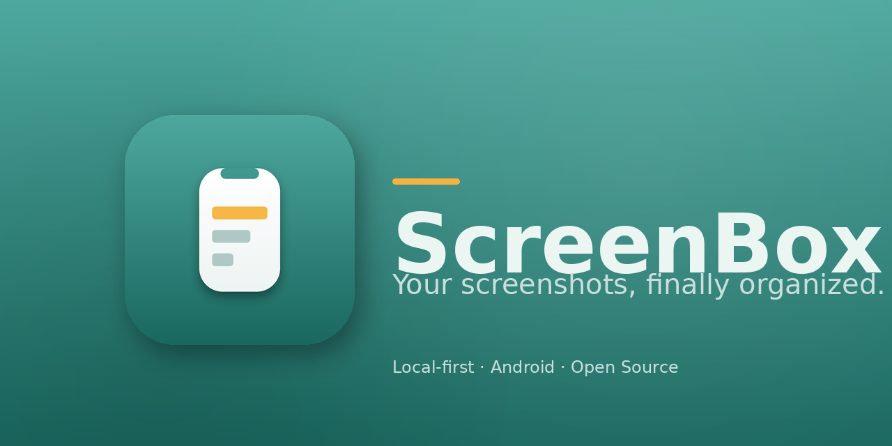
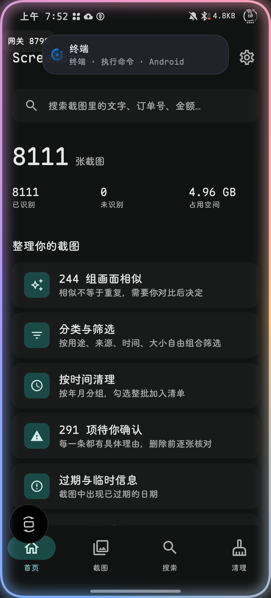
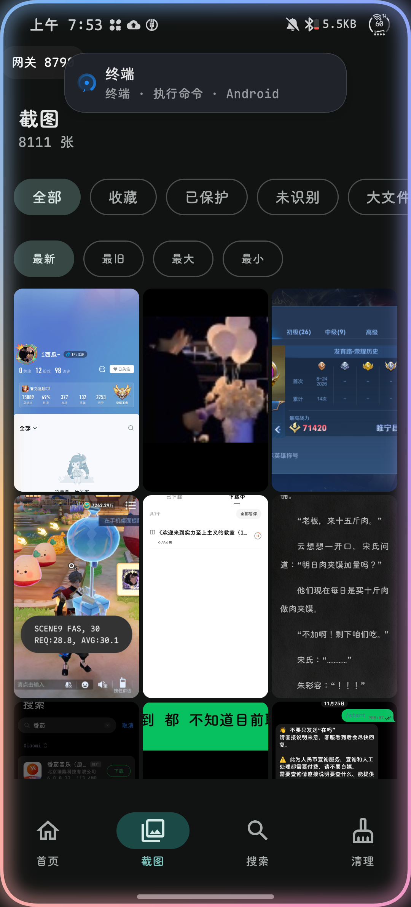
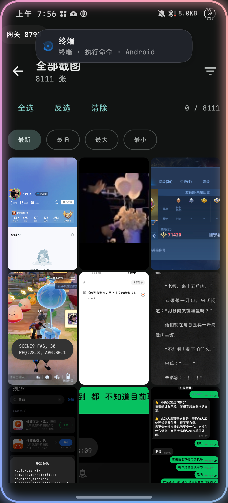
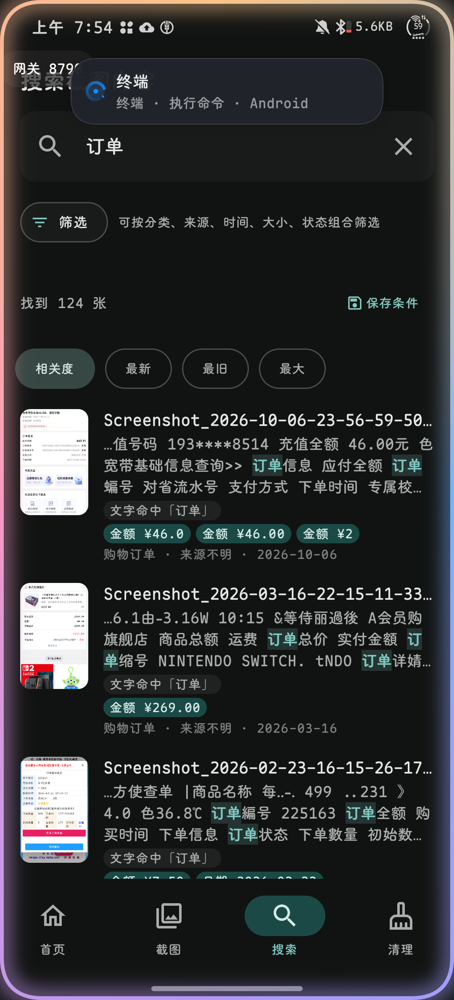
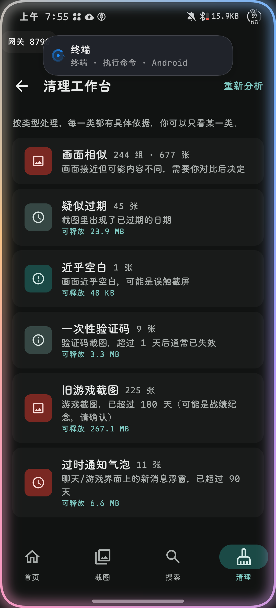
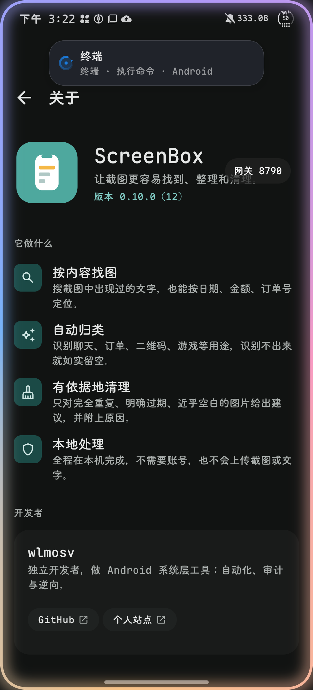

<div align="center">



# ScreenBox

**Your screenshots, finally organized.**

A local-first Android screenshot organizer that helps you find, understand, organize, and safely clean up your screenshots.

[-4EA89E?style=flat-square)](https://github.com/wlmosv-png/ScreenBox/releases)
[](LICENSE)
[+-4EA89E?style=flat-square)](docs/BUILDING.md)
[](.github/workflows/android.yml)
[](app/src/test)

**中文文档：[README.zh-CN.md](README.zh-CN.md)**

</div>

---

ScreenBox lives in the place your screenshots pile up — the system photo library. It scans your screenshots locally, reads the text inside them, sorts them by what they actually show, and helps you clean up the ones that have outlived their purpose. Everything runs on your device. ScreenBox does not request network access, and it cannot upload anything even if you wanted it to.

> **First public release: `0.10.0 (12)` — Preview.** Core flows are verified on a real Android 15 device and covered by 115 unit tests. Android 10–14 are not yet verified on real hardware — see [Compatibility](#compatibility) for exactly what has and has not been tested.

## Contents

- [The problem](#the-problem)
- [What it does](#what-it-does)
- [Screenshots](#screenshots)
- [Privacy & safety](#privacy--safety)
- [Installation](#installation)
- [Compatibility](#compatibility)
- [Documentation](#documentation)
- [Building](#building)
- [Contributing](#contributing)
- [License](#license)

## The problem

Screenshots are easy to take and hard to find. After a few months, the photo library is a mixed pile:

- A screenshot of an order, a QR code, a chat, and a game, all in the same grid — and you cannot remember which is which.
- You know a screenshot of that receipt or confirmation exists, but you cannot find it without scrolling through hundreds of images.
- Old screenshots — expired coupons, one-time codes, stale notifications — quietly take up storage, and you are not sure what is safe to delete.
- Batch cleanup feels risky: you are afraid of deleting something that mattered.

ScreenBox does not invent new anxiety. It just makes that pile searchable, sorted, and safely manageable.

## What it does

Every capability below maps to code that is actually implemented and tested in this repository.

**Find by content, not by memory.** ScreenBox runs on-device OCR over your screenshots and lets you search the text that appears inside them — a date, an amount, an order number, a phrase. It also recognizes structured entities (dates, amounts, long IDs) so you can search for them directly.

**Automatic categorization.** Screenshots are classified into categories that reflect what they show — chat, order, QR code, game, social. When ScreenBox is not confident about a screenshot, it leaves it uncategorized rather than guessing. You can also see which app a screenshot came from.

**Filter by source, time, and content.** Filter by category, source app, time window, file size, and recognition state. Facets show you how many screenshots match each condition, so you are never selecting blindly. Filters can be saved and restored.

**Preview and batch management.** Browse screenshots in a grid or timeline, preview any image with zoom, and batch-select to favorite, protect, or prepare for deletion.

**Evidence-based cleanup.** The cleanup workbench suggests screenshots that are exact duplicates, possibly expired, near-blank, one-time codes, stale notifications, or old game/social screenshots — each with a human-readable reason and the evidence behind it. There is no "delete because you haven't opened it in a while."

**Protected deletion.** Favorite and protect screenshots you want to keep. They are excluded from selection, from cleanup suggestions, and from the delete plan — checked at three separate points before anything is removed. Deletion goes through the Android system authorization flow, never a silent internal delete.

**Local-first by design.** ScreenBox requests no network permission. OCR uses a model bundled inside the APK. Your screenshots and the text extracted from them stay on your device.

## Screenshots

All screenshots below are from the real `0.10.0 (12)` build running on an Android 15 device.

<div align="center"><br><sub>Home — overview of your screenshot library</sub></div>

<div align="center"><br><sub>Gallery — browse, filter, and batch-select</sub></div>

<div align="center"><br><sub>Browse — filter by category, source, and time</sub></div>

<div align="center"><br><sub>Search — find screenshots by the text inside them</sub></div>

<div align="center"><br><sub>Cleanup workbench — suggestions with reasons</sub></div>

<div align="center"><br><sub>Delete plan — review before anything is removed</sub></div>

<div align="center"><br><sub>About — version, capabilities, and open-source info</sub></div>

## Privacy & safety

ScreenBox is built around a simple principle: your screenshots are your data, and they should not leave your phone.

- **Local-first.** ScreenBox processes screenshots on your device. It does not require an account and does not sync anything to a cloud.
- **No network permission.** The app's manifest requests no `INTERNET` permission. There is no code path that can upload your screenshots or the text extracted from them — the capability does not exist at the system level.
- **Media access follows Android authorization.** ScreenBox reads screenshots through Android's media authorization (`READ_MEDIA_IMAGES`, partial-photo selection on Android 14+, legacy storage on older versions). It reads only what you authorize.
- **No root.** ScreenBox is a standard Android app. It does not require root and does not use it.
- **It does not read other apps' private directories.** ScreenBox scans the media locations you authorize through the system media provider — nothing else.
- **Deletion follows the system flow.** When you delete, ScreenBox uses Android's `MediaStore.createDeleteRequest` authorization flow. Deletion is never a silent internal operation, and a result the system claims but the file still present is recorded as a failure, not a false success.
- **Protection and review before deletion.** Favorites and protected items are excluded from selection, from cleanup suggestions, and from the delete plan — verified at three points. Every cleanup suggestion carries a reason and evidence.

**About the OCR model.** ScreenBox uses Google ML Kit's on-device Chinese text recognition. The model is bundled inside the APK and runs locally — it does not download at runtime and, because the app has no network permission, it cannot transmit recognition results. ML Kit's bundled Firebase telemetry is disabled at startup.

## Installation

**Requirements**

- Android 10 (API 29) or later.
- No root required.
- Photos/media authorization.

**Download**

Grab the latest stable-preview APK from the [Releases page](https://github.com/wlmosv-png/ScreenBox/releases).

**Verify the download**

Every release ships a `sha256sum.txt`. Check it before installing:

```bash
sha256sum -c sha256sum.txt
```

**Install**

```bash
adb install -r ScreenBox-0.10.0-12.apk
```

Or install it directly from the file on your phone. On first launch, grant the photo/media authorization. On Android 14+, you can choose to grant access to all photos or only selected photos.

**Signing certificate**

The preview APK is signed with the following certificate (verify with `apksigner verify --print-certs`):

| Digest | Value |
|---|---|
| SHA-256 | `c2b69717b9e230fac3ce74b544f33a792e8a6c97da058d5345cbb53cb4c7319e` |
| SHA-1 | `6617f9d394d6133bbf9927474c5ef1f2c66cbbfc` |

## Compatibility

ScreenBox targets Android 10 (API 29) through Android 15 (API 35). This is what has actually been tested:

| Android version | Status | Notes |
|---|---|---|
| 15 (API 35) | ✅ Verified on real hardware | OnePlus PJX110. Full walkthrough: scan, OCR, search, classify, cleanup, delete authorization, background tasks. |
| 10–14 (API 29–34) | ⚠️ Not yet verified on real hardware | Permission-decision branches are covered by unit tests, but real-device system dialog behavior, OEM customizations, and revoked-permission behavior are **not verified**. |

The permission model is implemented per-version (legacy storage ≤ API 32, `READ_MEDIA_IMAGES` on API 33, partial-photo selection on API 34+), and these branches are unit-tested. **That is not the same as having run on those devices.** If you are on Android 10–14, please consider reporting your experience via the [compatibility issue template](.github/ISSUE_TEMPLATE/compat_report.yml) — success reports matter too.

## Documentation

- [CHANGELOG.md](CHANGELOG.md) — version history
- [CONTRIBUTING.md](CONTRIBUTING.md) — how to contribute
- [SECURITY.md](SECURITY.md) — how to report a security issue
- [PRIVACY.md](PRIVACY.md) — privacy policy in detail
- [docs/ARCHITECTURE.md](docs/ARCHITECTURE.md) — how the app is structured
- [docs/BUILDING.md](docs/BUILDING.md) — how to build from source

## Building

ScreenBox is a standard Gradle Android project. See [docs/BUILDING.md](docs/BUILDING.md) for the full process. Quick start:

```bash
./gradlew assembleDebug        # build debug APK
./gradlew testDebugUnitTest    # run unit tests
```

## Contributing

Contributions are welcome — bug reports, compatibility reports, feature ideas, and code. See [CONTRIBUTING.md](CONTRIBUTING.md). Please use the issue templates so the report is actionable.

## License

ScreenBox is licensed under the [Apache License 2.0](LICENSE).

Third-party components are listed in the About screen inside the app and are licensed under Apache-2.0 (AndroidX / Compose, Kotlin, Room, WorkManager, Navigation, Coil), Google ML Kit Terms (ML Kit text recognition), and Public Domain (SQLite).
