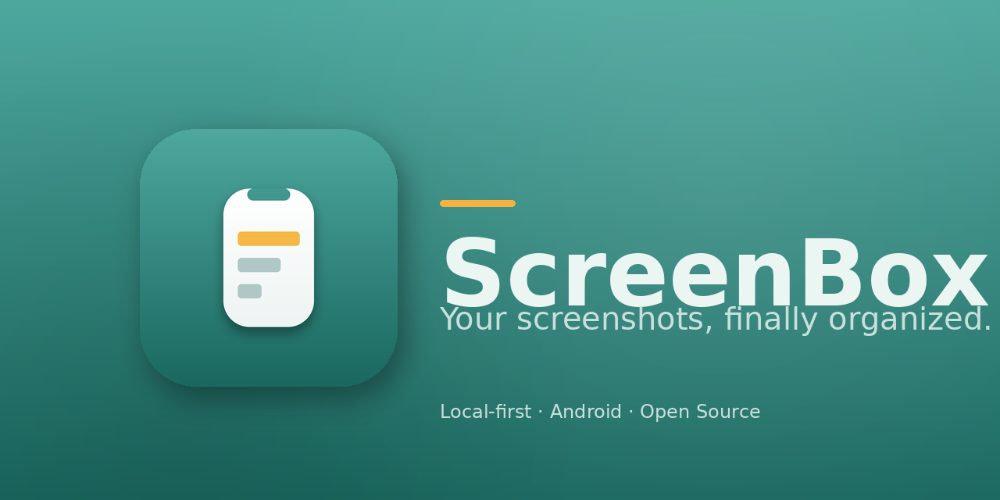
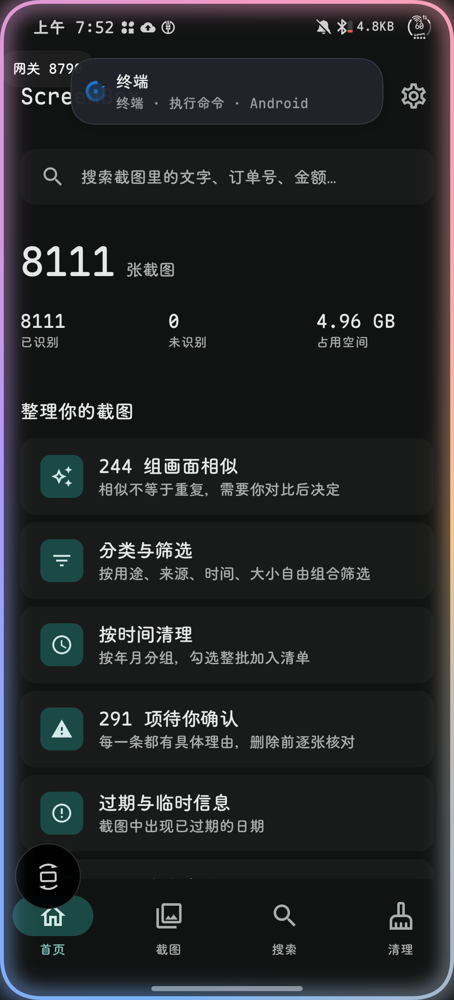
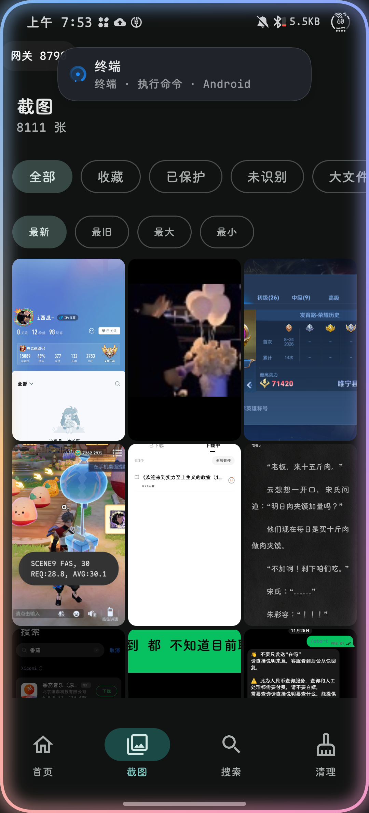
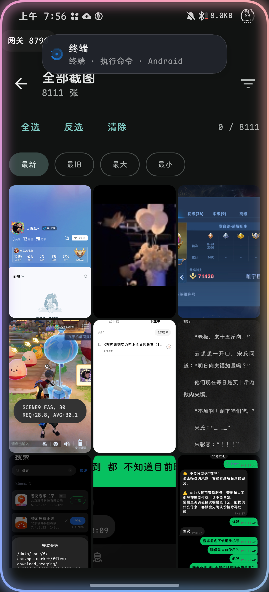
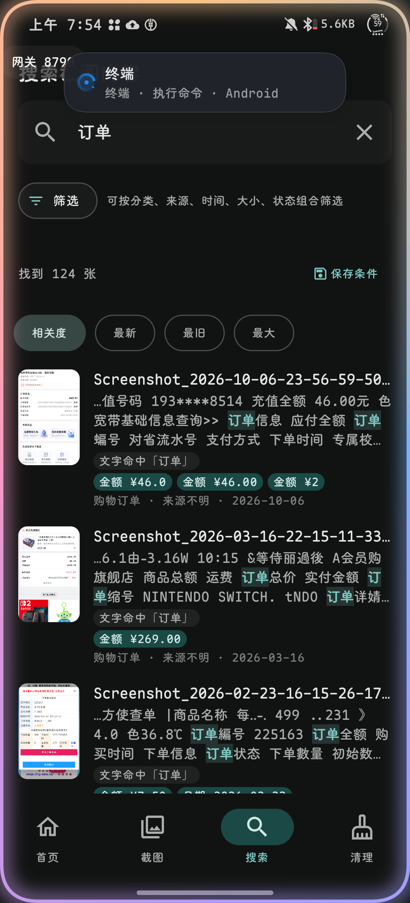
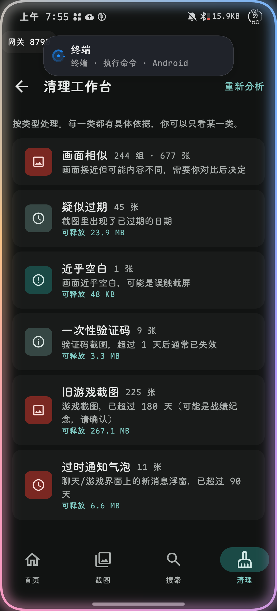
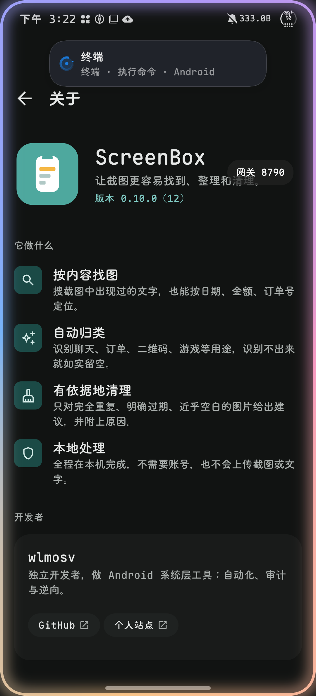

<div align="center">



# ScreenBox

**你的截图，终于整理好了。**

一个本地优先的 Android 截图整理工具，帮你找到、理解、整理，并安全地清理截图。

[-4EA89E?style=flat-square)](https://github.com/wlmosv-png/ScreenBox/releases)
[](LICENSE)
[+-4EA89E?style=flat-square)](docs/BUILDING.md)
[](.github/workflows/android.yml)
[](app/src/test)

**English docs: [README.md](README.md)**

</div>

---

ScreenBox 活在截图堆积的地方——系统相册。它在你的设备上扫描截图，读出里面的文字，按截图实际呈现的内容归类，并帮你清理那些已经失去用途的旧图。所有处理都在本机完成。ScreenBox 不申请网络权限，即使你希望它上传，它也没有这个能力。

> **首个公开版本：`0.10.0 (12)` —— Preview。** 核心流程已在 Android 15 真机上验证，并由 115 项单元测试覆盖。Android 10–14 尚未在真机上验证——[兼容性](#兼容性)一节如实写明了哪些测过、哪些没测。

## 目录

- [问题](#问题)
- [它能做什么](#它能做什么)
- [产品截图](#产品截图)
- [隐私与安全](#隐私与安全)
- [安装](#安装)
- [兼容性](#兼容性)
- [项目文档](#项目文档)
- [构建](#构建)
- [参与贡献](#参与贡献)
- [许可证](#许可证)

## 问题

截图拍得容易，找起来难。过了几个月，相册里就混成了一堆：

- 订单、二维码、聊天、游戏截图全挤在一个网格里，你想不起哪张是哪张。
- 你记得某张收据或确认截图存在，却要在几百张图里翻很久。
- 过期的截图——失效的优惠券、一次性验证码、过期的通知——悄悄占着存储，你又不确定哪些能删。
- 批量清理让人心里没底，怕误删重要的东西。

ScreenBox 不制造新的焦虑。它只让这堆图变得可搜、可归类、可安全地管理。

## 它能做什么

下面每一项都对应本仓库中真实实现、真实测试的代码。

**按内容找图，不靠记忆。** ScreenBox 在本机对截图做 OCR，可以搜索截图里出现过的文字——日期、金额、订单号、一句话。它还能识别结构化实体（日期、金额、长编号），可以直接按这些内容搜索。

**自动归类。** 截图按实际呈现的内容归类——聊天、订单、二维码、游戏、社交。当 ScreenBox 不确定时，它会如实留空，而不是硬猜一个类别。你也可以查看截图来自哪个应用。

**按来源、时间、内容筛选。** 按分类、来源应用、时间窗口、文件大小、识别状态筛选。每个条件旁直接显示命中张数，让你不用盲选。筛选条件可以保存、恢复。

**预览与批量管理。** 在网格或时间轴中浏览截图，缩放预览任意一张，批量选择后收藏、保护或准备删除。

**有依据地清理。** 清理工作台会建议这些截图：完全重复、可能已过期、近乎空白、一次性验证码、过期通知、旧游戏/旧社交截图——每条都带一句人能读懂的理由和背后的证据。不存在「因为很久没打开就建议删」。

**受保护的删除。** 收藏和保护你不想动的截图。它们会被排除在选择之外、排除在清理建议之外、排除在删除清单之外——在真正删除前经过三道检查。删除走 Android 系统授权流程，绝不静默内部删除。

**本地优先。** ScreenBox 不申请网络权限。OCR 用的是随 APK 打包的模型。你的截图和从中提取的文字都留在本机。

## 产品截图

以下截图全部来自真实的 `0.10.0 (12)` 构建，运行在一台 Android 15 设备上。

<div align="center"><br><sub>首页——截图库总览</sub></div>

<div align="center"><br><sub>图库——浏览、筛选、批量选择</sub></div>

<div align="center"><br><sub>浏览——按分类、来源、时间筛选</sub></div>

<div align="center"><br><sub>搜索——按截图里的文字找图</sub></div>

<div align="center"><br><sub>清理工作台——带理由的清理建议</sub></div>

<div align="center"><br><sub>删除清单——删除前先核对</sub></div>

<div align="center"><br><sub>关于——版本、能力与开源信息</sub></div>

## 隐私与安全

ScreenBox 围绕一个简单的原则构建：截图是你的数据，它不该离开你的手机。

- **本地优先。** ScreenBox 在本机处理截图。不需要账号，也不向云端同步任何内容。
- **不申请网络权限。** 应用清单里没有 `INTERNET` 权限。不存在任何能把你的截图或提取出的文字上传的代码路径——这个能力在系统层面就不存在。
- **媒体访问遵循 Android 授权。** ScreenBox 通过 Android 的媒体授权读取截图（`READ_MEDIA_IMAGES`、Android 14+ 的部分照片授权、旧版本的存储权限）。它只读取你授权的内容。
- **不需要 Root。** ScreenBox 是标准的 Android 应用，不需要 Root，也不使用 Root。
- **不读取其他应用的私有目录。** ScreenBox 只扫描你通过系统媒体提供方授权的媒体位置，不碰其他东西。
- **删除遵循系统流程。** 删除时，ScreenBox 使用 Android 的 `MediaStore.createDeleteRequest` 授权流程。删除绝不是静默的内部操作；如果系统声称成功但文件仍在，会记录为失败，而不是假成功。
- **删除前的保护与核对。** 收藏和受保护项会被排除在选择、清理建议和删除清单之外——三处核对。每条清理建议都带理由和证据。

**关于 OCR 模型。** ScreenBox 使用 Google ML Kit 的本地中文文字识别。模型随 APK 打包，在本机运行——运行时不会下载，而且由于应用没有网络权限，它也无法上传识别结果。ML Kit 自带的 Firebase 统计已在启动时通过反射关闭。

## 安装

**要求**

- Android 10（API 29）及以上。
- 不需要 Root。
- 照片/媒体授权。

**下载**

从 [Releases 页面](https://github.com/wlmosv-png/ScreenBox/releases) 获取最新的预览版 APK。

**校验下载**

每个 Release 都附带 `sha256sum.txt`。安装前请校验：

```bash
sha256sum -c sha256sum.txt
```

**安装**

```bash
adb install -r ScreenBox-0.10.0-12.apk
```

或在手机上直接从文件安装。首次启动时，请授予照片/媒体授权。在 Android 14+ 上，你可以选择授予全部照片或仅选中照片。

**签名证书**

预览版 APK 使用以下证书签名（可用 `apksigner verify --print-certs` 核对）：

| 摘要 | 值 |
|---|---|
| SHA-256 | `c2b69717b9e230fac3ce74b544f33a792e8a6c97da058d5345cbb53cb4c7319e` |
| SHA-1 | `6617f9d394d6133bbf9927474c5ef1f2c66cbbfc` |

## 兼容性

ScreenBox 面向 Android 10（API 29）到 Android 15（API 35）。以下是实际测试情况：

| Android 版本 | 状态 | 说明 |
|---|---|---|
| 15（API 35） | ✅ 真机验证 | OnePlus PJX110。完整走查：扫描、OCR、搜索、分类、清理、删除授权、后台任务。 |
| 10–14（API 29–34） | ⚠️ 尚未真机验证 | 权限判定分支有单元测试覆盖，但真机的系统弹框行为、厂商定制、权限撤销后的行为**尚未验证**。 |

权限模型按版本实现（API ≤ 32 用旧存储权限、API 33 用 `READ_MEDIA_IMAGES`、API 34+ 支持部分照片授权），这些分支都有单元测试。**但这不等于在这些设备上真正跑过。** 如果你在使用 Android 10–14，欢迎通过[兼容性上报模板](.github/ISSUE_TEMPLATE/compat_report.yml)反馈你的体验——成功上报同样重要。

## 项目文档

- [CHANGELOG.md](CHANGELOG.md)——版本历史
- [CONTRIBUTING.md](CONTRIBUTING.md)——如何参与贡献
- [SECURITY.md](SECURITY.md)——如何报告安全问题
- [PRIVACY.md](PRIVACY.md)——详细隐私政策
- [docs/ARCHITECTURE.md](docs/ARCHITECTURE.md)——应用结构
- [docs/BUILDING.md](docs/BUILDING.md)——如何从源码构建

## 构建

ScreenBox 是标准的 Gradle Android 工程。完整流程见 [docs/BUILDING.md](docs/BUILDING.md)。快速开始：

```bash
./gradlew assembleDebug        # 构建 debug APK
./gradlew testDebugUnitTest    # 运行单元测试
```

## 参与贡献

欢迎各种贡献——Bug 报告、兼容性上报、功能建议和代码。见 [CONTRIBUTING.md](CONTRIBUTING.md)。请使用 Issue 模板，让报告可执行。

## 许可证

ScreenBox 采用 [Apache License 2.0](LICENSE)。

第三方组件在应用内的关于页列出，许可证分别为 Apache-2.0（AndroidX / Compose、Kotlin、Room、WorkManager、Navigation、Coil）、Google ML Kit 条款（ML Kit 文字识别）和 Public Domain（SQLite）。
