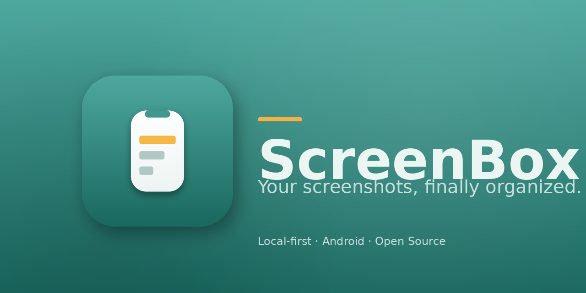
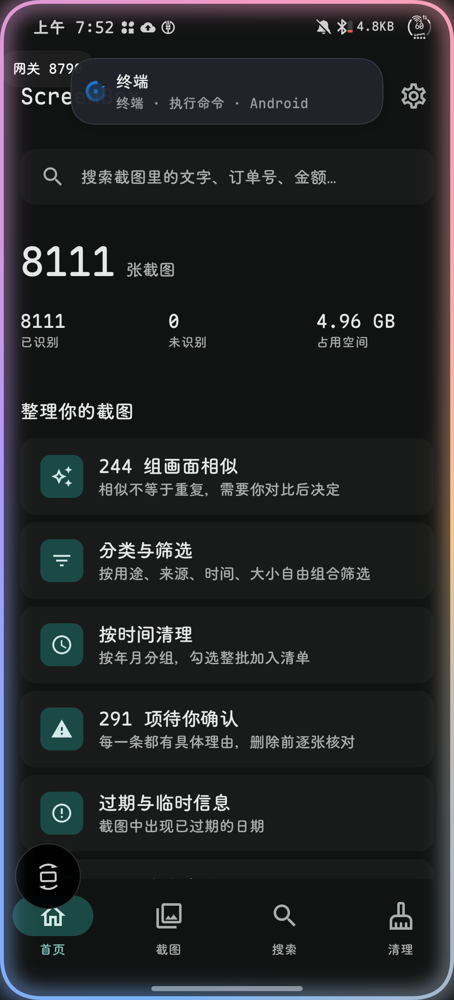
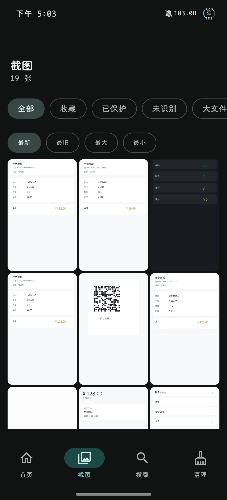
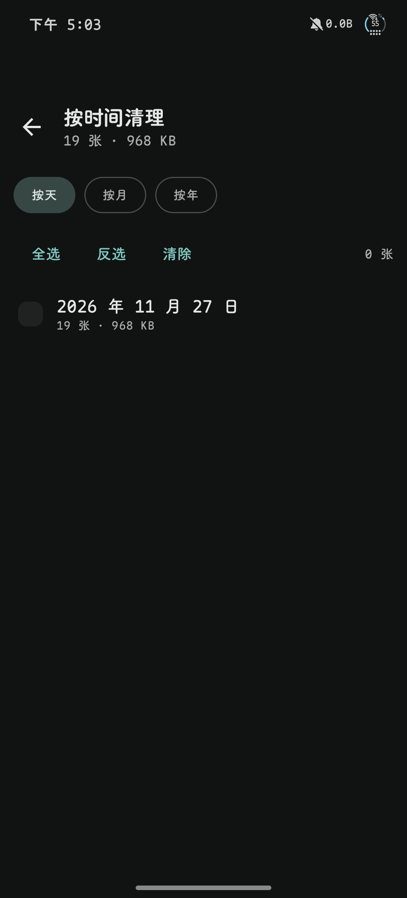
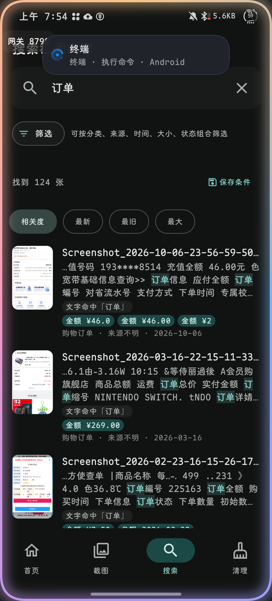
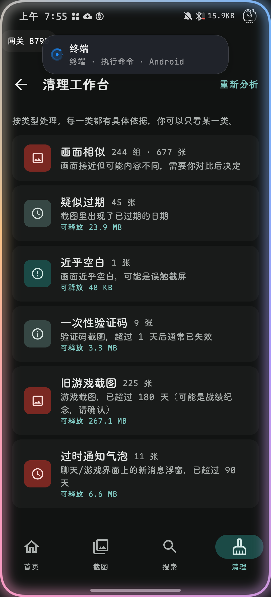
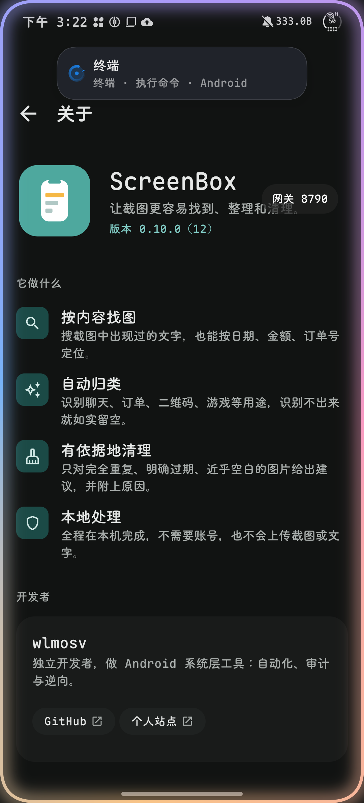

<div align="center">



# ScreenBox

**Your screenshots, finally organized.**

A local-first Android screenshot organizer that helps you find, understand, organize, and safely clean up your screenshots.

[-4EA89E?style=flat-square)](https://github.com/wlmosv-png/ScreenBox/releases)
[](LICENSE)
[+-4EA89E?style=flat-square)](docs/BUILDING.md)
[](.github/workflows/android.yml)
[](app/src/test)

**中文文档（主文档）：[README.md](README.md)**

</div>

---

> **Note:** ScreenBox's UI is currently Chinese-only. This English README describes the project; the app itself has not been localized to English yet.

ScreenBox lives where your screenshots pile up — the system photo library. It scans your screenshots on-device, reads the text inside them, sorts them by what they actually show, and helps you clean up the ones that have outlived their purpose. Everything runs on your phone. ScreenBox requests no network permission — it cannot upload anything even if you wanted it to.

> **Current release: `0.10.1 (13)`.** Core flows are verified on a real Android 15 device and covered by 115 unit tests (1 skipped). Android 10–14 are not yet verified on real hardware — see [Compatibility](#compatibility).

## The problem

Screenshots are easy to take and hard to find. After a few months the library is a mixed pile: order confirmations, QR codes, chat snippets, game results and expired coupons all in one grid — and you cannot remember which is which. Batch cleanup feels risky because you are afraid of deleting something that mattered.

ScreenBox does not add anxiety. It makes that pile searchable, sorted, and safely manageable.

## What it does

Every capability below maps to code that is implemented and tested in this repository.

- **Find by content.** On-device OCR reads the text inside screenshots; search a date, amount, order number, or a phrase that appears in one. Structured entities (dates, amounts, long IDs) are searchable too.
- **Automatic categorization.** Screenshots are classified into chat / order / QR code / game / social. When unsure, ScreenBox leaves a screenshot uncategorized instead of guessing. The source app is also detected.
- **Filter by source, time, and content.** Category, source app, time window, file size, and recognition state — with live facet counts, so you never select blindly. Filters can be saved and restored.
- **Preview and batch management.** Browse in a grid or timeline, zoom a preview, batch-select to favorite, protect, or prepare for deletion.
- **Evidence-based cleanup.** The workbench suggests exact duplicates, possibly-expired, near-blank, one-time codes, stale notifications, and old game/social screenshots — each with a human-readable reason and the underlying evidence. There is no "delete because you haven't opened it in a while".
- **Protected deletion.** Favorites and protected items are excluded from selection, from cleanup suggestions, and from the delete plan — checked at three points. Deletion goes through Android's system authorization flow, never a silent internal delete.
- **Local-first.** No `INTERNET` permission. The OCR model is bundled in the APK.

## Screenshots

All screenshots below are from the real `0.10.1 (13)` build on an Android 15 device, using clean demo data.

<div align="center"><br><sub>Home — library overview and task entry points</sub></div>

<div align="center"><br><sub>Gallery — browse, categorize, batch-select</sub></div>

<div align="center"><br><sub>Browse — filter by category, source, and time</sub></div>

<div align="center"><br><sub>Search — find screenshots by the text inside them</sub></div>

<div align="center"><br><sub>Cleanup workbench — suggestions with reasons</sub></div>

<div align="center"><br><sub>About — version, capabilities, and open-source info</sub></div>

## Privacy & safety

- **Local-first.** Processing happens on your device. No account, no cloud sync.
- **No network permission.** The manifest requests no `INTERNET` permission. The capability to upload does not exist at the system level.
- **Media access follows Android authorization.** (`READ_MEDIA_IMAGES`, partial-photo selection on Android 14+, legacy storage on older versions.)
- **No root.** ScreenBox is a standard Android app.
- **Deletion follows the system flow.** Uses `MediaStore.createDeleteRequest`; a result the system claims but the file still present is recorded as a failure, not a false success.
- **Protection and review before deletion.** Favorites/protected items are excluded at three checkpoints; every suggestion carries a reason and evidence.

**About the OCR model.** Google ML Kit's on-device Chinese text recognition, bundled inside the APK. It does not download at runtime, and with no network permission it cannot transmit results. ML Kit's bundled Firebase telemetry is disabled at startup.

## Installation

**Requirements:** Android 10 (API 29)+, no root, photo/media authorization.

Download the **single APK** from the [Releases page](https://github.com/wlmosv-png/ScreenBox/releases), verify its SHA-256 against `sha256sum.txt`, then:

```bash
adb install -r ScreenBox-0.10.1-13.apk
```

**Signing certificate**

| Digest | Value |
|---|---|
| SHA-256 | `c2b69717b9e230fac3ce74b544f33a792e8a6c97da058d5345cbb53cb4c7319e` |
| SHA-1 | `6617f9d394d6133bbf9927474c5ef1f2c66cbbfc` |

## Compatibility

| Android version | Status |
|---|---|
| 15 (API 35) | ✅ Verified on real hardware (OnePlus PJX110) |
| 10–14 (API 29–34) | ⚠️ Not yet verified on real hardware — permission branches are unit-tested, but system dialog / OEM behavior is unverified |

Minimum: Android 10 (API 29). No root required.

## Documentation

- [CHANGELOG.md](CHANGELOG.md) — version history
- [CONTRIBUTING.md](CONTRIBUTING.md) — how to contribute
- [SECURITY.md](SECURITY.md) — reporting security issues
- [PRIVACY.md](PRIVACY.md) — privacy policy
- [docs/ARCHITECTURE.md](docs/ARCHITECTURE.md) — app structure
- [docs/BUILDING.md](docs/BUILDING.md) — building from source
- [docs/FAQ.md](docs/FAQ.md) — FAQ

## Building

```bash
./gradlew assembleDebug        # build debug APK
./gradlew testDebugUnitTest    # run unit tests (115, all green)
```

## License

Apache License 2.0. Third-party components are listed in the in-app About screen.